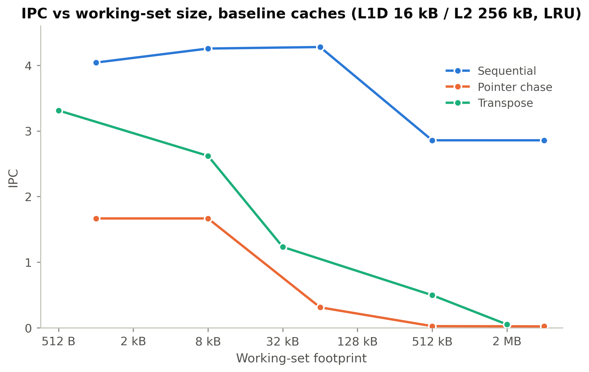
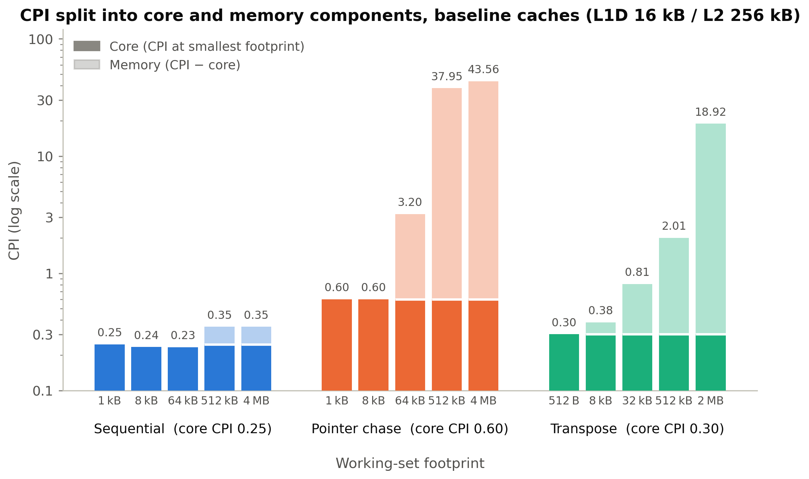
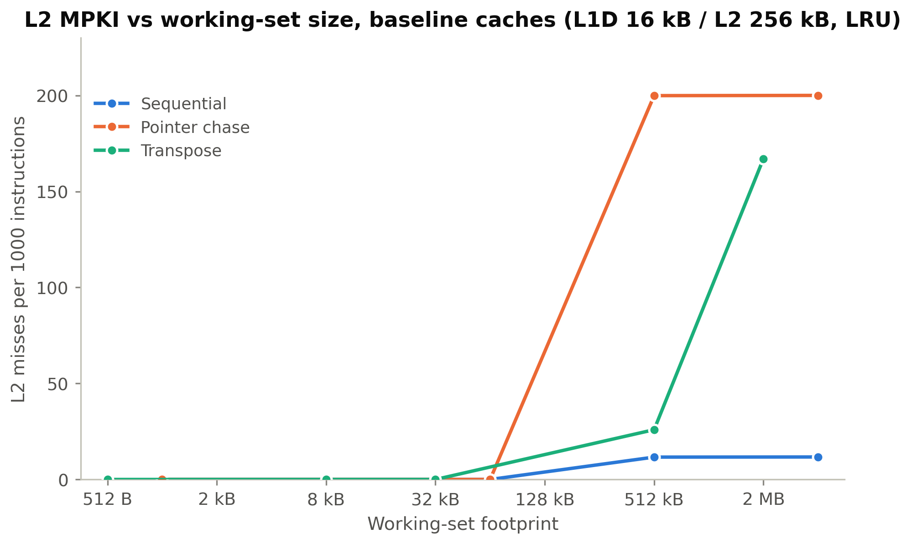
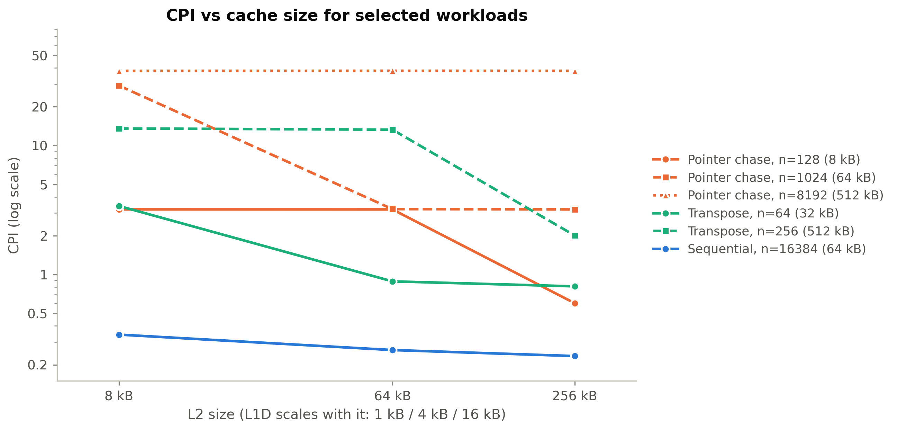

# EEL6764 Project Progress Report

**Bigger or Smarter? Trading Last-Level Cache Capacity Against Cache Policy in gem5**

Nuojunxi Zhang, Satvik Praveen, Ahmed Lamidi, Shengji Jin

## 1. Project Overview

AMD's 3D V-Cache triples the L3 cache from 32 MB to 96 MB, but extra cache costs area, power and money. We want to know how much last-level cache a workload actually needs, and whether a smarter replacement policy can get the same performance out of a smaller cache.

**Hypotheses.**
1. Performance improves with L2 size only until the working set fits. After that, extra capacity gives almost nothing.
2. Different replacement policies need different amounts of capacity to reach the same performance, so a better policy can save cache space.

**Changes since the proposal.**
- The "random access" microbenchmark is now a pointer chase, where each load depends on the previous one. This makes miss latency easy to see.
- We added matrix transpose because it mixes reuse with streaming, which is the case where policies should differ most.
- We fixed the L1 at 16 kB and only change the L2, as in the proposal.
- The hot-region mode, matrix multiply and BFS are not run yet.

## 2. Workload and Simulation Infrastructure

### 2.1 Simulator Configuration

- **Simulator:** gem5 v24.0 (course fork), syscall-emulation mode, X86. Built and working in the course Docker container.
- **CPU:** out-of-order (O3) core, 8-wide, 192-entry reorder buffer, 3 GHz.
- **Caches:** private 16 kB L1 instruction and data caches (8-way, LRU). Private L2 used as the last-level cache (16-way). L2 sizes tested so far are 8 kB, 64 kB and 256 kB.
- **Memory:** single-channel DDR4-2400. A DRAM access takes about 130 cycles.
- **Modifications:** no gem5 source changes. We wrote a config script that sets the cache sizes and replacement policy from the command line, plus scripts to run a list of jobs and collect the stats into a CSV.

### 2.2 Workloads

| Workload | What it does | Working set tested |
|---|---|---|
| Sequential | Sums an array front to back | 1 kB to 4 MB |
| Pointer chase | Follows a random linked list, one load at a time | 1 kB to 4 MB |
| Transpose | Copies an n×n matrix into its transpose | 512 B to 2 MB |

Each workload has five input sizes so it goes from fitting in the cache to being much larger than it. Every program checks its own output, and all 45 runs passed. We picked these three because they behave very differently: sequential is easy to prefetch, pointer chase has no reuse at all, and transpose has some reuse that can be lost.

### 2.3 Metrics Collected

- **IPC / CPI:** main performance metric.
- **L2 misses per thousand instructions (MPKI):** shows how well the L2 is working. We use MPKI instead of miss rate because the L2 miss rate looks misleading when the L1 catches almost everything.
- **Branch mispredictions:** collected, but below 3 percent everywhere, so they do not matter here.
- **Stall cycles:** fraction of cycles where nothing commits, and reorder-buffer-full events.

## 3. Preliminary Bottleneck Analysis

Baseline: 16 kB L1, 256 kB L2, LRU.

| Workload | n | Working set | IPC | CPI | L1D MPKI | L2 MPKI | Cycles with no commit |
|---|---|---|---|---|---|---|---|
| Sequential | 256 | 1 kB | 4.04 | 0.25 | 0 | 0 | 2% |
| Sequential | 2048 | 8 kB | 4.26 | 0.24 | 0 | 0 | 0% |
| Sequential | 16384 | 64 kB | 4.28 | 0.23 | 2.6 | 0 | 1% |
| Sequential | 131072 | 512 kB | 2.86 | 0.35 | 27.9 | 11.6 | 37% |
| Sequential | 1048576 | 4 MB | 2.86 | 0.35 | 27.8 | 11.7 | 37% |
| Pointer chase | 16 | 1 kB | 1.67 | 0.60 | 0 | 0 | 33% |
| Pointer chase | 128 | 8 kB | 1.67 | 0.60 | 0 | 0 | 33% |
| Pointer chase | 1024 | 64 kB | 0.31 | 3.20 | 200 | 0 | 88% |
| Pointer chase | 8192 | 512 kB | 0.026 | 37.9 | 200 | 200 | 99% |
| Pointer chase | 65536 | 4 MB | 0.023 | 43.6 | 200 | 200 | 99% |
| Transpose | 8 | 512 B | 3.31 | 0.30 | 0 | 0 | 0% |
| Transpose | 32 | 8 kB | 2.62 | 0.38 | 0 | 0 | 12% |
| Transpose | 64 | 32 kB | 1.23 | 0.81 | 57.7 | 0 | 58% |
| Transpose | 256 | 512 kB | 0.50 | 2.01 | 122 | 25.9 | 79% |
| Transpose | 512 | 2 MB | 0.053 | 18.9 | 167 | 167 | 98% |

**Where the cycles go.** Figure 2 splits CPI into a "core" part (the CPI when everything fits in L1) and a "memory" part (the extra CPI from misses). For pointer chase and transpose with large inputs, almost all of the CPI is memory. In those runs about 98 to 99 percent of cycles commit nothing because the core is waiting on a load.

**Why.**
- **Pointer chase** is limited by latency. Each load has to wait for the previous one, so the core cannot overlap misses. Its CPI follows the latency of whichever level the list fits in.
- **Transpose** writes down columns, so each write touches a new cache line. Once the matrix is bigger than the L2, almost every write misses.
- **Sequential** stays fast at every size because the prefetcher fetches the next lines before they are needed.

## 4. Planned Design Exploration

**Next step.** Run the same workloads with four L2 replacement policies: LRU (done), Random, SRRIP and BRRIP. gem5 already has all four, and our script can select them. The L1 stays at 16 kB with LRU.

**Initial results.** Figure 4 shows CPI as the cache gets bigger. The curves are flat until the working set fits, then drop. Transpose at 512 kB goes from CPI 13 to CPI 2 when the L2 grows from 64 kB to 256 kB. Pointer chase at 512 kB does not improve at all because it never fits. This supports hypothesis 1.

**Expected trade-offs.** SRRIP and BRRIP should help transpose by keeping reused lines in the cache instead of streaming data. They should not help pointer chase, since it has no reuse. RRIP policies need about 2 bits per cache line, which is cheaper than full LRU.

## 5. Preliminary Insights and Challenges

**What we learned.**
- The access pattern matters more than the cache size. The same L2 gives transpose a large speedup and pointer chase none.
- L2 miss rate alone can be misleading, so MPKI is a better metric.
- gem5's built-in cache setup ignores the L2 associativity setting, so we set it ourselves.

**Problems and fixes.**
- The gem5 build ran out of memory in Docker. We gave Docker more memory and built with fewer parallel jobs.
- The container had the wrong gem5 branch. We switched to the course branch.
- The gem5 benchmark download service is offline, so we will compile BFS ourselves.

## 6. Remaining Work and Timeline

| Week | Task |
|---|---|
| 4 | Run Random, SRRIP and BRRIP on all workloads and L2 sizes |
| 5 | Add the hot-region microbenchmark, matrix multiply and BFS |
| 6 | Plot IPC vs L2 size per policy, find the smallest L2 each policy needs |
| 7 | Analyze results and write the report |
| 8 | Final report and presentation |
