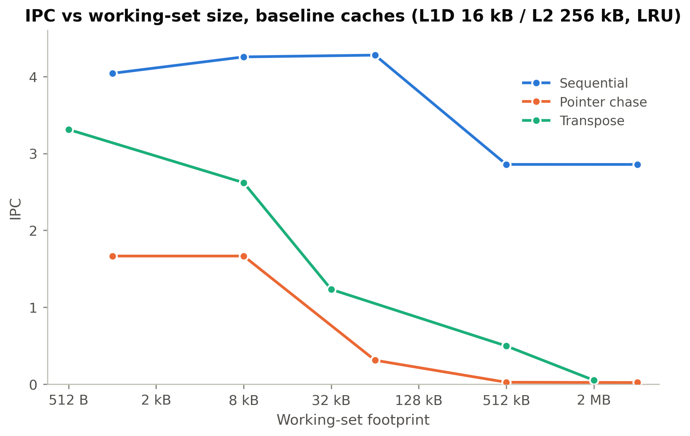
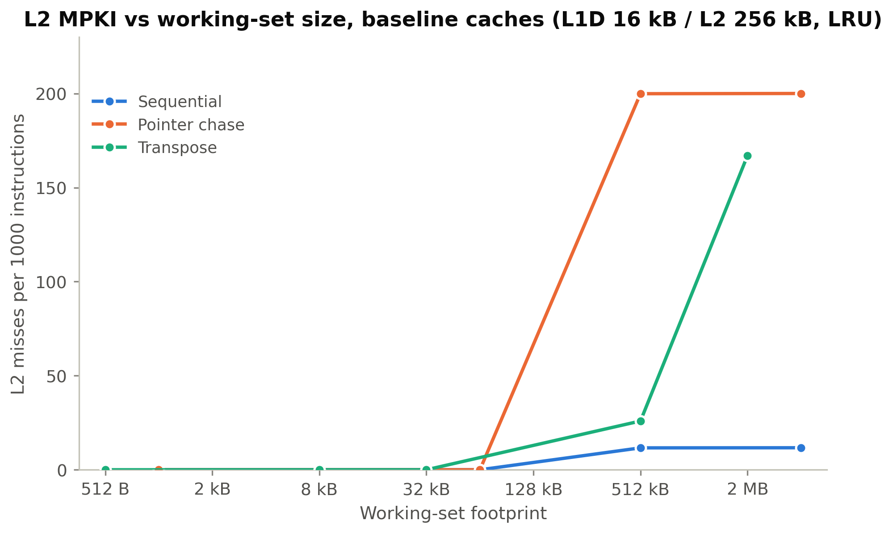
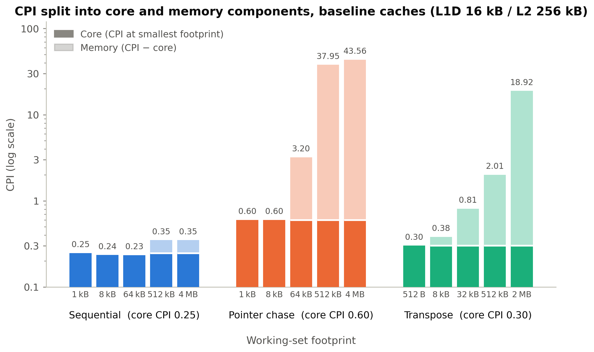
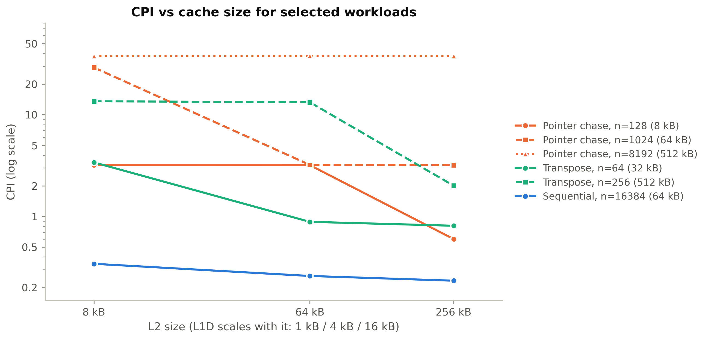

# EEL6764 Project Progress Report (Fall 2026)

**Project title:** Bigger or Smarter? Trading Last-Level Cache Capacity Against Cache Policy in gem5

**Team:** Nuojunxi Zhang, Satvik Praveen, Ahmed Lamidi, Shengji Jin

## 1. Project Overview

**Problem.** Motivated by AMD's 3D V-Cache, which triples the L3 from 32 MB on the Ryzen 7 9700X to 96 MB on the 9800X3D, we study how much last-level cache (LLC) capacity a workload actually needs, and whether a better replacement policy can deliver the same performance from a smaller cache. Extra capacity costs die area, power and price, so a policy that reaches a given hit rate with less capacity is a direct efficiency win.

**Research question and hypotheses.** (1) Performance improves with LLC capacity only until the working set fits; beyond that the gain is negligible, and the threshold rises with the working set. (2) The capacity needed to reach near-best performance differs across replacement policies, so a scan-resistant policy (SRRIP, BRRIP) may match LRU's performance at reduced capacity on some access patterns and not on others.

**Scope refinements since the proposal.**
- The "random access" microbenchmark mode became a *dependent* pointer chase. Each load's address comes from the previous load, which removes memory-level parallelism and makes the cost of every miss visible in CPI. Independent random loads would be partly hidden by the out-of-order core.
- Matrix transpose was added as a third microbenchmark mode. It mixes a sequential read stream with a column-strided write stream, so it has reuse that a scan can evict, which is the case the scan-resistant policies target.
- The L1 caches are now pinned at 16 kB instruction and 16 kB data, with LRU, for the policy comparison. The L2 is the only cache whose size and policy vary, as the proposal specifies. The first sweep (reported below) scaled the L1 together with the L2; those runs are used for the capacity trend and the fixed-L1 configuration is the baseline for the policy study.
- The hot-region-plus-random mode, matrix multiply, and BFS from the GAP suite are not yet run (Section 6).

## 2. Workload and Simulation Infrastructure

### 2.1 Simulator Configuration

**Status.** gem5 v24.0.0.1 (the course fork, branch `class`) is built and running in the course Docker container in syscall-emulation mode with the X86 ISA. A baseline and a 45-run sweep have completed with correct output on every run.

| Component | Setting (fixed across all runs unless stated) |
|---|---|
| CPU | X86O3CPU, 8-wide fetch/decode/rename/issue/commit, 192-entry ROB, 64-entry IQ, 32-entry LQ and SQ, 256 integer and 256 FP physical registers, tournament branch predictor, 3 GHz |
| L1I / L1D | Private, 8-way, 1-cycle tag and data, 16 MSHRs, stride prefetcher, LRU. Fixed at 16 kB each for the policy study (the first sweep also used 1 kB and 4 kB) |
| L2 (LLC) | Private, 16-way, 10-cycle tag + 10-cycle data, 20 MSHRs, mostly inclusive, stride prefetcher. **Size varied:** 8 kB, 64 kB, 256 kB (1 MB to be added). **Policy varied:** LRU done; Random, SRRIP, BRRIP next |
| Line size | 64 B |
| Memory | Single-channel DDR4-2400 (8x8 devices), 4 GB. Measured average DRAM access latency about 130 cycles; L1-miss-to-fill latency about 215 cycles when the L2 also misses |
| Mode | Syscall emulation, one core, statistics reset and dumped around the kernel with m5ops |

**Modifications implemented.** No gem5 C++ source was changed. We wrote:
- A gem5 configuration script that builds the standard-library private-L1/private-L2 board and then overrides, on every cache, the size, associativity, replacement policy and prefetcher from command-line flags. All gem5 policies are selectable (LRU, Random, FIFO, RRIP (gem5's SRRIP), BRRIP, DRRIP, BIP, LIP, NRU, TreePLRU and others). The script validates the set count, writes the resolved configuration to `run_config.json` beside the stats, and auto-detects the binary's ISA.
- Region-of-interest markers (`m5_reset_stats` / `m5_dump_stats`) linked into every benchmark through `libm5.a`, so the first statistics block covers only the kernel and excludes setup and verification.
- A job-list runner (one benchmark invocation per line), a stats collector that reads the first block of each run into a CSV, and a plotting script.

One gem5 quirk found along the way: the standard-library hierarchy accepts an `l2_assoc` argument but never passes it to the L2, which is therefore always 16-way. Our override sets it explicitly, so the reported associativity is the real one.

### 2.2 Workloads

Three microbenchmark modes are written, verified and swept. Each takes the working-set parameter `n` and a repeat count so that every run commits a similar number of instructions, and each checks its own result and exits non-zero on error. All 45 runs passed.

| Workload | Access pattern | Footprint | n swept | Footprints | Instructions in ROI |
|---|---|---|---|---|---|
| Sequential | Sum a 32-bit array front to back, repeated | 4n B | 256, 2048, 16384, 131072, 1048576 | 1 kB to 4 MB | 10.5 M |
| Pointer chase | Follow a random single-cycle permutation through 64-byte nodes; each load depends on the previous one | 64n B | 16, 128, 1024, 8192, 65536 | 1 kB to 4 MB | 5.0 M (1 M dependent loads) |
| Transpose | B[j][i] = A[i][j] on two n×n 32-bit matrices: row-wise reads, column-strided writes | 8n² B | 8, 32, 64, 256, 512 | 512 B to 2 MB | 6.3 to 7.5 M |

**Justification.** The three span the cases a replacement policy must handle. Sequential is a pure scan: the prefetcher serves it and a policy can only hurt by letting the scan evict other data. Pointer chase has no reuse and no parallelism, so it bounds what any policy or any capacity can achieve: performance is set purely by where the chain fits. Transpose reuses each row of A across a column pass while the writes to B stream through, so it is the workload where a scan-resistant policy should let a smaller L2 behave like a larger one. Input sizes were chosen so that every workload ranges from fitting in the smallest L2 to several times the largest.

Matrix multiply (IJK order, with ROI markers) is compiled and tested but not yet swept. BFS from GAP is not yet built; the gem5-resources catalogue that would have provided prebuilt binaries is offline, so it will be compiled from source.

### 2.3 Metrics Collected

All metrics come from the first statistics block (the kernel region) of each run.

- **IPC / CPI:** `commitStats0.numInsts` over `numCycles`. Execution time from `simTicks`.
- **Cache:** overall miss rate and miss count for L1D, L1I and L2; misses per thousand instructions (MPKI) for L1D and L2; average miss latency per level; DRAM read requests and row-buffer hit rate. MPKI is the primary cache metric because the L2 miss *rate* is undefined or misleading when the L1 absorbs almost everything.
- **Branch mispredictions:** `branchPred.condIncorrect` over `condPredicted`, and `commit.branchMispredicts`.
- **Stall cycles:** cycles in which zero instructions commit (`commit.numCommittedDist::0`), cycles rename is blocked, and ROB-full, IQ-full and LQ/SQ-full events.
- **Other:** per-run `run_config.json` to confirm the intended configuration, and host wall-clock time (57 minutes for the 45-run set, 4.3 minutes for the longest run).

## 3. Preliminary Bottleneck Analysis

### 3.1 Baseline results (L1 16 kB / 16 kB, L2 256 kB, LRU)

| Workload | n | Footprint | IPC | CPI | L1D MPKI | L2 MPKI |
|---|---|---|---|---|---|---|
| Sequential | 256 | 1 kB | 4.04 | 0.247 | 0 | 0 |
| | 2048 | 8 kB | 4.26 | 0.235 | 0 | 0 |
| | 16384 | 64 kB | 4.28 | 0.234 | 2.6 | 0 |
| | 131072 | 512 kB | 2.86 | 0.350 | 27.9 | 11.6 |
| | 1048576 | 4 MB | 2.86 | 0.350 | 27.8 | 11.7 |
| Pointer chase | 16 | 1 kB | 1.67 | 0.600 | 0 | 0 |
| | 128 | 8 kB | 1.67 | 0.600 | 0 | 0 |
| | 1024 | 64 kB | 0.31 | 3.20 | 200 | 0 |
| | 8192 | 512 kB | 0.026 | 37.9 | 200 | 200 |
| | 65536 | 4 MB | 0.023 | 43.6 | 200 | 200 |
| Transpose | 8 | 512 B | 3.31 | 0.302 | 0 | 0 |
| | 32 | 8 kB | 2.62 | 0.382 | 0 | 0 |
| | 64 | 32 kB | 1.23 | 0.811 | 57.7 | 0 |
| | 256 | 512 kB | 0.50 | 2.01 | 122 | 25.9 |
| | 512 | 2 MB | 0.053 | 18.9 | 167 | 167 |

Figure 1 plots IPC against working-set footprint for the baseline configuration, with the L1D and L2 sizes marked; Figure 3 plots the matching L2 MPKI. The full table of 45 runs is in `lru_sweep_runs.csv`.

L2 MPKI can slightly exceed L1D MPKI at the largest footprints because the L2's own stride prefetcher issues requests that are counted as L2 misses.

### 3.2 Stall breakdown

| Run (baseline config) | CPI | Cycles with 0 commits | Rename blocked | ROB-full events | IQ-full events | Cond. branch mispred. | Avg L1D miss latency |
|---|---|---|---|---|---|---|---|
| Chase n=16 (in L1) | 0.60 | 33% | 0% | 1.33 M | 2 | 0.001% | n/a |
| Chase n=1024 (in L2) | 3.20 | 88% | 83% | 1.33 M | 2 | 0.000% | 14 cycles |
| Chase n=65536 (DRAM) | 43.6 | 99% | 99% | 1.33 M | 0 | 0.000% | 216 cycles |
| Sequential n=16384 (in L2) | 0.23 | 1% | 0% | 0 | 117 k | 0.006% | 10 cycles |
| Sequential n=1048576 (DRAM) | 0.35 | 37% | 32% | 8.8 k | 123 k | 0.000% | 108 cycles |
| Transpose n=32 (in L1) | 0.38 | 12% | 3% | 0 | 0 | 2.8% | n/a |
| Transpose n=256 (L2 partial) | 2.01 | 79% | 27% | 12 k | 1 | 0.38% | 23 cycles |
| Transpose n=512 (DRAM) | 18.9 | 98% | 7% | 279 | 1 | 0.19% | 114 cycles |

**Approximate CPI stack.** Taking each workload's CPI at its smallest footprint as the core (non-memory) component, the memory component is CPI minus that value:

| Workload | Core CPI | Memory CPI at 64 kB | at 512 kB | at 2 to 4 MB |
|---|---|---|---|---|
| Sequential | 0.24 | 0.00 | 0.10 | 0.10 |
| Pointer chase | 0.60 | 2.60 | 37.3 | 43.0 |
| Transpose | 0.30 | 0.51 | 1.71 | 18.6 |

Figure 2 shows the same split for every baseline run. (Sequential's core value is taken as 0.25 from its 1 kB run; its 8 kB and 64 kB runs are marginally faster, so their memory component is clamped at zero.)

### 3.3 Where cycles are spent

- **Pointer chase** is entirely latency-bound. Each step of the chain is five instructions and one load that cannot issue until the previous load returns, so CPI equals the load-to-load latency divided by five: 3 cycles (L1 hit) gives 0.60, 16 cycles (L2 hit) gives 3.2, and about 190 to 216 cycles (DRAM) gives 38 to 44. The ROB fills with about 38 chain steps that all wait on the head load, which is why rename is blocked on ROB-full for 99 percent of cycles and nothing commits. At 4 MB the DRAM row-buffer hit rate falls to 5 percent, which adds the last 5 cycles per step over the 512 kB case.
- **Transpose** is bound by its column-strided stores. Each store to B touches a new 64-byte line (stride 4n bytes), so at n=512 nearly every store misses both L1 and L2 (167 L2 MPKI, 1.1 M DRAM reads) and 98 percent of cycles commit nothing. The stores are independent, so some memory-level parallelism exists, but the 32-entry store queue and 20 L2 MSHRs cap it. At n=256 the 256 kB L2 holds half the 512 kB working set and the row-wise reuse of A keeps it useful: L2 MPKI is 26 rather than 167 and CPI is 2.0 rather than 19.
- **Sequential** never becomes a bottleneck. The stride prefetcher and the 16 L1 MSHRs keep the stream ahead of the core; even from DRAM the core still commits the full 8 instructions in half of its cycles, and the only stall source is IQ-full, which is the core saturating, not the memory. Measured DRAM bandwidth is 6.9 GB/s against a 19.2 GB/s channel, so it is neither latency- nor bandwidth-limited.
- **Branch prediction** is not a factor anywhere: the worst case is transpose at n=32 (2.8 percent of conditionals, short inner loops), which costs well under 0.1 CPI.

### 3.4 Why these bottlenecks occur

The core is 8-wide with a 192-entry window, so it is never the limiter for these loops. Cycles are lost only when a miss cannot be overlapped with useful work. Pointer chase has zero overlap by construction, so its performance is a step function of which level the chain fits in, and neither capacity nor policy can change the height of the steps, only where they occur. Transpose has reuse (rows of A) that is destroyed when the write stream through B evicts them; this is precisely the scan-versus-reuse conflict that LRU handles badly and that SRRIP and BRRIP are designed for, so it is the workload where we expect the policy axis to matter. Sequential has no reuse and a perfectly predictable stride, so capacity and policy are irrelevant to it; its role in the study is as the scan that must not be allowed to pollute the cache for the other data.

## 4. Planned Design Exploration and Optimization

**Being implemented.** The policy axis: L2 replacement policy LRU (done), Random (control), SRRIP (`RRIPRP` in gem5) and BRRIP (`BRRIPRP`), with the L1 caches held at 16 kB and LRU in every run. The configuration script already selects all four; the remaining change is to apply the flag to the L2 only. The L2 size range will be 8 kB, 64 kB, 256 kB and 1 MB so that every workload's largest working set can also fit. Total: 3 workloads × 5 sizes × 4 L2 sizes × 4 policies = 240 runs, about 5 hours at 4 runs in parallel.

**Initial sensitivity trend.** The first sweep varied the L2 across 8 kB, 64 kB and 256 kB (with the L1 scaled alongside), all under LRU. Figure 4 shows the capacity threshold predicted by the first hypothesis: each workload's CPI is flat until the footprint crosses the L2 size and then jumps. Pointer chase crosses at 64 kB with the small L2, 512 kB with the medium and large ones. Transpose at a 512 kB footprint has CPI 13.6, 13.3 and 2.0 with the 8 kB, 64 kB and 256 kB L2, so the largest L2 moves the knee one step to the right. Sequential is within 0.12 CPI across all sizes.

| Working set | CPI, L2 = 8 kB | L2 = 64 kB | L2 = 256 kB |
|---|---|---|---|
| Chase 8 kB | 3.20 | 3.20 | 0.60 |
| Chase 64 kB | 29.1 | 3.22 | 3.20 |
| Chase 512 kB | 37.9 | 38.0 | 37.9 |
| Transpose 32 kB | 3.40 | 0.89 | 0.81 |
| Transpose 512 kB | 13.6 | 13.3 | 2.01 |
| Sequential 64 kB | 0.343 | 0.260 | 0.234 |

(The L1 was 1, 4 and 16 kB in the three columns, so part of the Chase 8 kB and Transpose 32 kB differences comes from the L1; the fixed-L1 rerun will separate the two.)

**Expected trade-offs.** SRRIP and BRRIP should protect the reused rows in transpose from the write scan and reach LRU's performance at a smaller L2, at a hardware cost of 2 bits of re-reference state per line rather than LRU's per-set ordering. Random should tie LRU on pointer chase, where nothing is reusable, and may equal or beat it on scans because it does not systematically keep the most recent, least useful lines. We expect no policy to help pointer chase beyond the capacity knee, which would confirm that the second hypothesis holds only for workloads with reuse.

## 5. Preliminary Insights and Current Challenges

**Observations and lessons.**
- Access pattern decides whether capacity helps at all. The same 256 kB L2 is worth a 10× CPI improvement for transpose at 512 kB and nothing for pointer chase at the same footprint.
- A workload can be memory-bound inside the L1. Pointer chase at 1 kB still costs 0.6 CPI because the dependency chain, not the cache, is the limit; cache experiments must separate latency from capacity effects.
- L2 miss rate is the wrong metric when the L1 filters the stream (it reads 100 percent on three L2 misses). MPKI against committed instructions is the comparable quantity, and gem5 omits zero-valued stats from `stats.txt`, which the collector has to treat as zero rather than missing.
- The standard-library hierarchy does not apply the L2 associativity it is given, so cache parameters must be verified from the resolved configuration, not from the script arguments.

**Roadblocks and mitigation.**
- The gem5 build was killed by the out-of-memory handler inside the Docker Desktop VM (3.7 GB, 8 jobs). Raising the VM to 9 GB and building with fewer parallel jobs fixed it.
- The container's gem5 checkout was upstream v24.0 rather than the course branch; switched to `class` and rebuilt.
- The gem5-resources download catalogue is offline (its backing database was retired), so GAP BFS and the matrix-multiply inputs will be compiled from source in the container rather than fetched.
- The team's development hosts are x86_64, so experiments use the X86 build; an ARM build is possible but was not needed for this study since the ISA is held constant.
- Run time scales with CPI: the 4 MB pointer chase takes 4 minutes per run, so the 240-run policy sweep is batched and run in parallel overnight.

## 6. Remaining Work and Timeline

| Week | Task |
|---|---|
| 4 (now) | Apply the policy flag to the L2 only; run the fixed-L1 sweep with L2 at 8 kB to 1 MB for LRU, Random, SRRIP and BRRIP (240 runs) |
| 5 | Add the hot-region-plus-random microbenchmark mode; build and run matrix multiply and GAP BFS at the largest sizes that simulate in reasonable time |
| 6 | Plots of IPC versus L2 size per policy and per workload; speedup over LRU at equal size; the smallest L2 at which each policy reaches 95 percent of its best IPC |
| 7 | Analysis: capacity saved per policy per workload, CPI stack per configuration, discussion of where the hypotheses hold |
| 8 | Final report and presentation |
